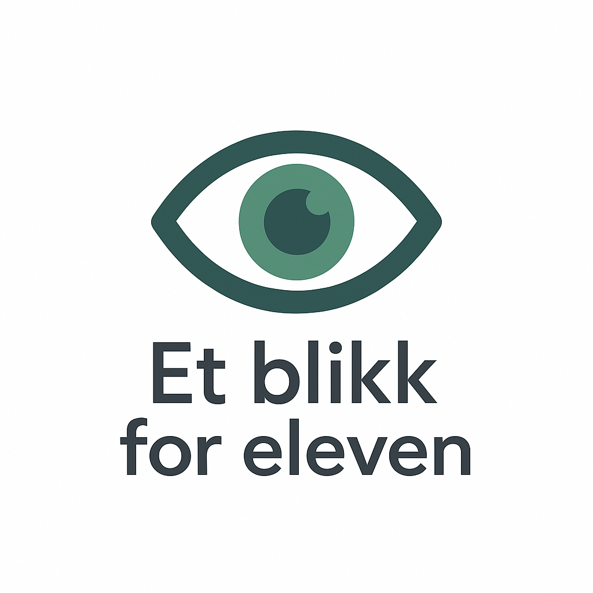
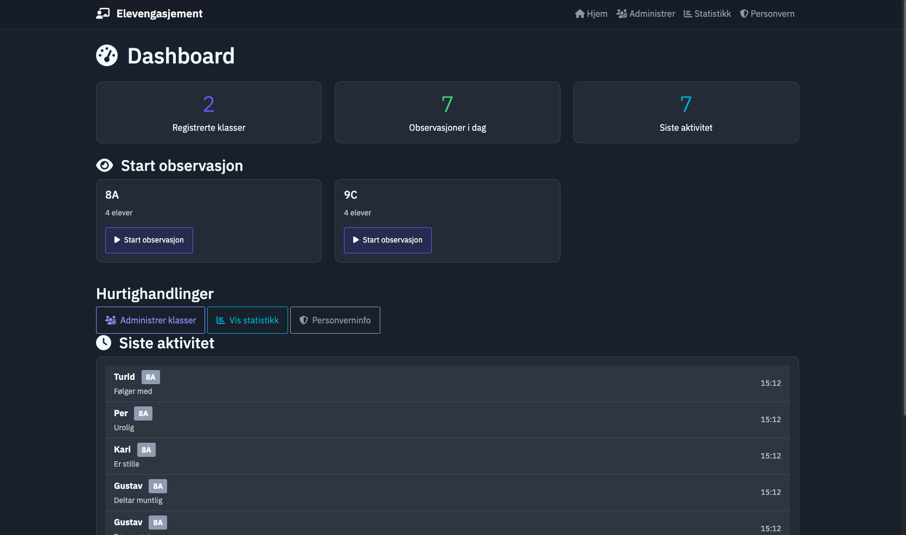

# 

**Et blikk for eleven** er et brukervennlig, 100% offline observasjonsverktøy for lærere. Appen lar deg registrere og følge opp elevengasjement og deltakelse – helt uten at sensitive data forlater din egen maskin.

---

## 🔒 Personvern og sikkerhet
- **All data lagres kun lokalt** på din datamaskin. Ingenting sendes til internett eller eksterne servere og det er innlogging med kode.
- Appen kan brukes trygt til elevobservasjoner.
- Kan installeres som PWA på mobil og PC for enkel tilgang og offline-bruk.

---

## 🚀 Funksjoner
- Registrer klasser og elever
- Start observasjon med ett klikk på hovedkategori
- Se siste aktivitet og statistikk
- Eksporter grafer som PNG
- Moderne, responsivt design
- Kan installeres på hjemskjerm (PWA)
- All data lagres lokalt (ingen skytjenester)

---

## 🖼️ Skjermbilde
Her er et glimt av dashboardet i Et blikk for eleven:



---

## 🧪 Kom i gang

Denne veiledningen viser deg hvordan du laster ned og kjører appen på din egen PC.  
Du må ha [Python](https://www.python.org/downloads/) installert.

1. **Last ned appen**  
   Klikk på den grønne **Code**-knappen øverst, velg **Download ZIP** og pakk ut filen.

2. **Åpne kommandovindu i riktig mappe**  
   - **Windows**: Finn mappen du lastet ned appen, hold inne **Shift**, høyreklikk og velg **Åpne PowerShell/Kommandovindu her**  
   - **Mac**: Høyreklikk mappen og velg **Åpne i Terminal**

3. **Installer det appen trenger**  
   ```bash
   pip install -r requirements.txt
   
4. **Kjør appen**
   ```
   python app.py
   ```
5. **Åpne i nettleseren** på [http://127.0.0.1:5000](http://127.0.0.1:5000)

6. **Stoppe appen** Trykk Ctrl + C i kommandovinduet.
   

---

## 📱 Bruk som PWA
- Åpne appen i Chrome/Edge på PC eller mobil.
- Velg «Legg til på Hjem-skjerm»/«Installer» fra nettlesermenyen.
- Appen fungerer offline og kan brukes uten nett så lenge mobil og PC er koblet på samme nett. Grunnen er at du starter appen på PC-en om morgenen, men kan bruke mobil til å observere hvis du ikke bruker PC.

---

## 📦 Avhengigheter

Appen krever følgende Python-pakker (installeres med `pip install -r requirements.txt`):
- **Flask**: Lettvekts web-rammeverk for Python. Brukes til å lage selve web-appen, håndtere ruter, servere HTML-sider, og ta imot brukerinput.
- **Flask-SQLAlchemy**: Integrasjon mellom Flask og SQLAlchemy (ORM for databaser). Gjør det enkelt å lagre og hente data (f.eks. observasjoner, elever, klasser) i en lokal databasefil (SQLite).
- **openpyxl**: Bibliotek for å lese og skrive Excel-filer (XLSX) i Python. Brukes for å eksportere observasjonsdata til Excel.
- **(Valgfritt) gunicorn**: Produksjonsserver for Python web-apper. Ikke nødvendig for lokal bruk, men nyttig hvis du vil kjøre Flask-appen på en server.

---

## Kontakt
Utviklet av [Kenneth Bareksten](https://laererliv.no)
